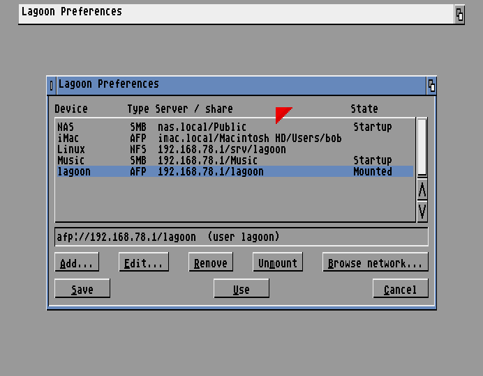
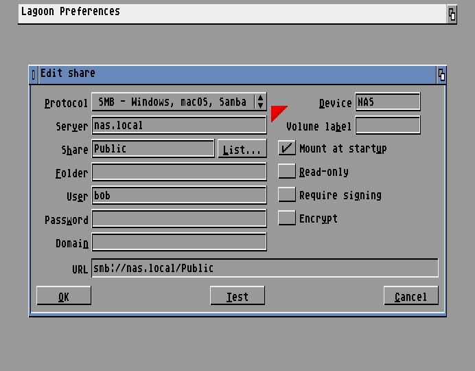

# Lagoon

Network shares on your Amiga: Lagoon mounts Windows/macOS/Samba shares (SMB
2 and 3), older Macs and Netatalk servers (AFP) and Unix servers (NFS v3) as
ordinary AmigaDOS volumes. It runs on AmigaOS 3.x (68020 or better) with any
bsdsocket.library TCP/IP stack and is developed with
[Riptide](https://github.com/farsonic/riptide).



## What it is

* **lagoon-handler** (`L:`): an AmigaDOS file system handler. Every share
  you mount becomes a device such as `NAS:` with a volume on Workbench;
  any program can open, save, copy, rename and delete files on it.
* **Lagoon** (`C:`): mounts and unmounts shares (`Lagoon MOUNT NAS`,
  `Lagoon UNMOUNT NAS`, `Lagoon MOUNTALL` at boot, `Lagoon LIST`).
* **LagoonPrefs** (`SYS:Prefs`): the share list editor, with a network
  browser that finds servers by mDNS/Bonjour and NetBIOS, share lists, and
  a Test button. GadTools only: no MUI needed.
* **Install_Lagoon**: an Installer script that sets it all up.

## Requirements

* 68020 or better, AmigaOS 3.0 (V39) or newer (real Amiga or WinUAE/FS-UAE)
* a TCP/IP stack: Riptide, Roadshow, Miami, AmiTCP or Genesis
* a server: Windows, a Mac, a NAS box, Samba, Netatalk or an NFS server

## Install

Unpack `lagoon-0.1.lha` (or use `lagoon-0.1.adf`) and double-click
**Install_Lagoon**. It copies the handler, the command and LagoonPrefs,
installs the translations (German, French, Spanish, Italian), keeps an
existing share list, warns when no TCP/IP stack is installed, and adds
`Lagoon MOUNTALL WAIT 30 >NIL:` to `S:User-Startup` after your stack's
block. Details and the manual way: [docs/install.md](docs/install.md).

## Quick start

1. Start your TCP/IP stack, then open **SYS:Prefs/LagoonPrefs**.
2. Press **Browse network...**: after a few seconds it lists the file
   servers on your network. Pick one and press **Use**.

   

3. The share editor opens with the server filled in. Enter your **User**
   and **Password**, press **List...** and pick the share (or type its
   name). The **Device** name is filled in for you (`Public` becomes
   `Public:`); change it if you like.

   

4. Press **Test**: it connects and shows the free space. Tick **Mount at
   startup** if you want the share at every boot, then **OK**.
5. Select the share and press **Mount**, then **Save**. The volume appears
   on Workbench.

From a Shell: `Lagoon MOUNT Public`, `Dir Public:`, `Lagoon UNMOUNT Public`.
LagoonPrefs in detail: [docs/prefs.md](docs/prefs.md).

## Protocols

| Protocol | Use it for | Notes |
|---|---|---|
| SMB 2.0.2 - 3.1.1 | Windows, macOS file sharing, Samba, NAS boxes | signing and encryption; SMB1 is not supported |
| AFP 3.x | Macs up to OS X 10.x, AFP-only Time Capsules, Netatalk | encrypted logins; clear text only if you allow it |
| NFS v3 (TCP) | Linux, BSD and Unix servers, NAS boxes | AUTH_SYS with the UID/GID you set |

Server names: DNS names, addresses, and `name.local` (Lagoon asks by
mDNS itself if the stack cannot). File names are converted between the
server's Unicode and the Amiga's ISO-8859-1; characters the Amiga cannot
show are kept as `%XX` escapes so every file stays reachable.

## Troubleshooting

* **"No TCP/IP stack is running"**: start your stack first; check it with
  `ping` to your server.
* **Browse finds nothing**: the server is in another subnet, or does not
  announce itself (Windows: turn on *Network discovery*; Samba: run Avahi
  or nmbd). Enter the server by name or address with **Add...**.
* **"logon failure"**: wrong user or password. On Windows, use the account
  name, not the e-mail address of a Microsoft account (or the PC's local
  account); for a domain, fill in **Domain**.
* **The share does not mount at boot**: is **Mount at startup** ticked and
  the list saved (**Save**, not only **Use**)? Is the `;BEGIN Lagoon` block
  in `S:User-Startup` after the stack's start?
* **macOS**: turn on *File Sharing* (System Settings > General > Sharing)
  and, under Options, *Share files and folders using SMB* for your user.
* More: the troubleshooting sections of [docs/prefs.md](docs/prefs.md).

## Building

```
make && make test        # native core + tests (Linux, gcc)
make amiga               # vbcc + NDK 3.2: build/amiga/
make package             # build/lagoon-0.1.lha (+ .adf), see docs/install.md
```

## Licence

GPL-2.0-only. Credits: [docs/CREDITS.md](docs/CREDITS.md).
