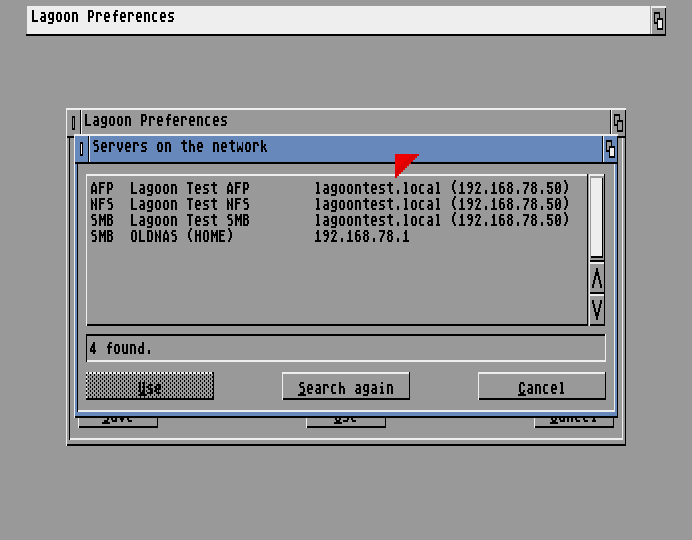
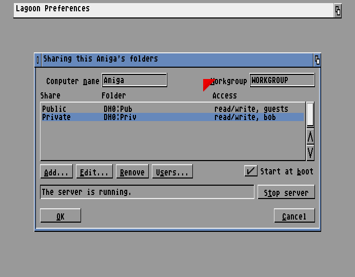
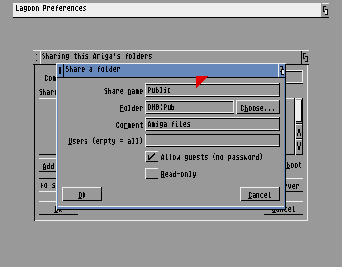

# Lagoon

[](https://buymeacoffee.com/farsonic)

Network shares on your Amiga: Lagoon mounts Windows/macOS/Samba shares (SMB
2 and 3), older Macs and Netatalk servers (AFP) and Unix servers (NFS v3) as
ordinary AmigaDOS volumes, and shares the Amiga's own folders with Windows,
macOS and Linux over SMB, with or without a password. It runs on AmigaOS 3.x (68020 or better) with any
bsdsocket.library TCP/IP stack and is developed with
[Riptide](https://github.com/farsonic/riptide).


## What it is

* **lagoon-handler** (`L:`): an AmigaDOS file system handler. Every share
  you mount becomes a device such as `NAS:` with a volume on Workbench;
  any program can open, save, copy, rename and delete files on it.
* **Lagoon** (`C:`): mounts and unmounts shares (`Lagoon MOUNT NAS`,
  `Lagoon UNMOUNT NAS`, `Lagoon MOUNTALL` at boot, `Lagoon LIST`), and
  shares Amiga folders (`Lagoon SHARE`, `Lagoon USER`, `Lagoon SERVE`).
* **LagoonPrefs** (`SYS:Prefs`): the share list editor, with a network
  browser that finds servers by mDNS/Bonjour and NetBIOS, share lists, and
  a Test button; its **Sharing** window shares your folders. GadTools only:
  no MUI needed.
* **Install_Lagoon**: an Installer script that sets it all up.

## Requirements

* 68020 or better, AmigaOS 3.0 (V39) or newer (real Amiga or WinUAE/FS-UAE)
* a TCP/IP stack: Riptide, Roadshow, Miami, AmiTCP or Genesis
* a server: Windows, a Mac, a NAS box, Samba, Netatalk or an NFS server

## Install

Unpack `lagoon-0.2.lha` (or use `lagoon-0.2.adf`) and double-click
**Install_Lagoon**. It copies the handler, the command and LagoonPrefs,
installs the translations (German, French, Spanish, Italian), keeps an
existing share list, warns when no TCP/IP stack is installed, and adds
`Lagoon MOUNTALL WAIT 30 >NIL:` to `S:User-Startup` after your stack's
block (and `Run >NIL: Lagoon SERVE AUTO WAIT 30`, which starts the file
server at boot when you tick *Start at boot* in the Sharing window).
Details and the manual way: [docs/install.md](docs/install.md).

## Quick start

1. Start your TCP/IP stack, then open **SYS:Prefs/LagoonPrefs**.
2. Press **Browse network...**: after a few seconds it lists the file
   servers on your network. Pick one and press **Use**.

   

3. The share editor opens with the server filled in. Enter your **User**
   and **Password**, press **List...** and pick the share (or type its
   name). The **Device** name is filled in for you (`Public` becomes
   `Public:`); change it if you like.

   

4. Press **Test**: it connects and shows the free space. Tick **Mount at
   startup** if you want the share at every boot, then **OK**.
5. Select the share and press **Mount**, then **Save**. The volume appears
   on Workbench.

From a Shell: `Lagoon MOUNT Public`, `Dir Public:`, `Lagoon UNMOUNT Public`.
LagoonPrefs in detail: [docs/prefs.md](docs/prefs.md).

## Sharing the Amiga's folders

Lagoon has an SMB server too: Windows, Macs and Linux machines can open
folders of your Amiga, read and write them.



In **LagoonPrefs** press **Sharing...**, then **Add...**: give the share a
name, pick the folder with **Choose...**, and either tick **Allow guests
(no password)** or add a user under **Users...** (a name and a password).
Press **Start server**; tick **Start at boot** to have it every time, then
**OK** and **Save**.



Or from a Shell:

```
Lagoon SHARE Public PATH Work:Public GUEST     ; no password needed
Lagoon SHARE Work PATH DH0:Work                ; for users with a password
Lagoon USER bob PASSWORD "a long passphrase"
Run >NIL: Lagoon SERVE                         ; Lagoon SERVE STOP stops it
```

Connect from the other computer:

* **Windows**: type `\\AMIGA\Public` (your Amiga's computer name, or its
  address: `\\192.168.1.20\Public`) in Explorer's address bar; for a
  password share enter the Amiga user, e.g. `bob`. Windows 11 (and recent
  Windows 10) refuse guest shares by default: use a password share there.
* **macOS**: Finder, *Go > Connect to Server...*, `smb://amiga.local/Public`
  (the Amiga also shows up under *Network* in the sidebar).
* **Linux**: `smbclient //amiga/Public -N`, `smbclient //amiga/Work -U bob`,
  or `sudo mount -t cifs //amiga/Work /mnt -o user=bob`; GNOME Files and
  Dolphin: `smb://amiga.local/`.

**Security:** Lagoon signs SMB messages for logged-on users but does not
encrypt them. Share only on a network you trust (your home LAN), never
forward ports 445/139 from the Internet, and use passwords for anything
private. The password is not stored, only its NT hash, which is still as
good as the password to an SMB client: keep `ENVARC:Lagoon/lagoon.conf`
private. Details, what is supported and what was tested:
[docs/server.md](docs/server.md).

## Protocols

| Protocol | Use it for | Notes |
|---|---|---|
| SMB 2.0.2 - 3.1.1 | Windows, macOS file sharing, Samba, NAS boxes | signing and encryption; SMB1 is not supported |
| AFP 3.x | Macs up to OS X 10.x, AFP-only Time Capsules, Netatalk | encrypted logins; clear text only if you allow it |
| NFS v3 (TCP) | Linux, BSD and Unix servers, NAS boxes | AUTH_SYS with the UID/GID you set |

Server names: DNS names, addresses, and `name.local` (Lagoon asks by
mDNS itself if the stack cannot). File names are converted between the
server's Unicode and the Amiga's ISO-8859-1; characters the Amiga cannot
show are kept as `%XX` escapes so every file stays reachable.

## Troubleshooting

* **"No TCP/IP stack is running"**: start your stack first; check it with
  `ping` to your server.
* **Browse finds nothing**: the server is in another subnet, or does not
  announce itself (Windows: turn on *Network discovery*; Samba: run Avahi
  or nmbd). Enter the server by name or address with **Add...**.
* **"logon failure"**: wrong user or password. On Windows, use the account
  name, not the e-mail address of a Microsoft account (or the PC's local
  account); for a domain, fill in **Domain**.
* **The share does not mount at boot**: is **Mount at startup** ticked and
  the list saved (**Save**, not only **Use**)? Is the `;BEGIN Lagoon` block
  in `S:User-Startup` after the stack's start?
* **macOS**: turn on *File Sharing* (System Settings > General > Sharing)
  and, under Options, *Share files and folders using SMB* for your user.
* More: the troubleshooting sections of [docs/prefs.md](docs/prefs.md).

## Building

```
make && make test        # native core + tests (Linux, gcc)
make amiga               # vbcc + NDK 3.2: build/amiga/
make package             # build/lagoon-0.2.lha (+ .adf), see docs/install.md
```

## Licence

GPL-2.0-only. Credits: [docs/CREDITS.md](docs/CREDITS.md).
