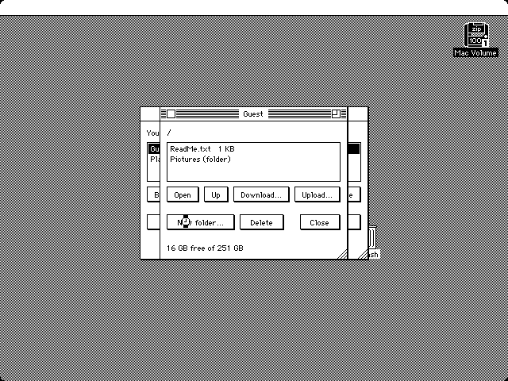

# Lagoon on the classic Mac OS

Lagoon's core (SMB 2/3, AFP, NFS v3, mDNS and NetBIOS discovery, `src/core`) runs on a 68020+
Macintosh under System 7, with a front end written once in MUI (`src/mui`) for both the Amiga and
the Mac. It was built for Aurora68 (an Emu68 port that runs a Mac IIci ROM on the Pi inside a Mac
SE), and needs only System 7 and Riptide.

## How it is put together

| Part | What |
|---|---|
| `src/core` | unchanged: compiled for the Mac with `m68k-linux-gnu-gcc` |
| `src/mac/sys_mac.c` | `ln_sys.h`: memory from the application heap, time from the Mac's clock and the Map control panel's zone, Command-period as the break, the Sharing Setup name as the host name |
| `src/mac/net_mac.c` | `ln_net.h` on Riptide's interface for programs (`RTMAC_API`, a private call of Riptide's `.IPP` driver): the stack's own socket calls, run in the program's context as `bsdsocket.library` runs in an Amiga task. While a call waits, Riptide calls back the program's yield, so the Mac carries on. MacTCP has no such interface: without Riptide, Lagoon says no TCP/IP stack is running |
| `src/mui/lm_gui.c` | the front end: the share list, Browse network (mDNS and NetBIOS), the share editor with List..., and a file browser for a connected share (Open, Up, Download..., Upload..., New folder..., Delete, free space). Built-in MUI classes only. Strings from `src/mui/catalogs/Lagoon.cd` (English built in; German, French, Spanish and Italian catalogs) |
| `src/mac/mac_main.c`, `mac_thunks.S` | the Mac's start, and the thunks that put the program's A5 back when Riptide or MUI calls in |
| `Makefile.mac` | builds `build/mac/Lagoon.bin` (MacBinary, `hcopy -m`) against a Riptide tree (`RIPTIDE ?= ../riptide`): its app kit (`src/mac/app`), its MUI for the Mac (`src/mac/mui`, riptide `docs/MAC-GUI.md`) and its tools, without copying them |

The share list is `ENVARC:Lagoon/lagoon.conf`, which on the Mac is the Lagoon folder in the
Preferences folder: the same file format as on the Amiga, passwords hidden the same way.

On the Amiga the same `src/mui` front end builds against MUI 3.8 (riptide's `prefs/mui.h`
definitions with the NDK). That build has not been made yet. vbcc, the NDK and the MUI SDK are not
installed where the Mac port was written, so on the Amiga side only the GCC compile with riptide's
headers is checked.

## Tested (18 November 2026)

On Aurora68's QEMU testbed (System 7.1, Riptide with DHCP). Its network peer (`tools/pinet.py` in
the Aurora68 repository) relays TCP to Lagoon's private Samba (`tests/servers/smb`) on the host
(`PINET_FORWARD=445=127.0.0.1:4450`), and mDNS queries to `tests/servers/mdns/responder.py`
(`PINET_MDNS_RELAY`). These worked:
- the share list from lagoon.conf;
- Connect to a guest share and to a password share (user "lagoon");
- the listing, Open a folder, Up, and the free space;
- Download... through Standard File (the file on the Mac matched the server's byte for byte);
- Upload... of a Mac file (data fork) to the share;
- New folder...;
- Delete with its confirmation.

`make test` on the host passes: 2936 checks against Samba, plus the unit tests.

Not tested: AFP and NFS from the Mac (no Netatalk or nfs-ganesha on the test host), Browse network
on the Mac (the testbed's mDNS relay is written, but the run was cut short), and the Amiga MUI
build. Two fixes made after the tested run have not been tried on the Mac yet: status lines that
redraw while shown (riptide 009a191), and the yes/no window without a text field.

Known gaps: files are copied by their data fork only (resource forks and Finder types are not
carried yet: AppleDouble or the AFP fork calls would do it), the password field shows what is
typed (the Mac's MUI has no secret string yet).

## AppleTalk: Lagoon's own EtherTalk (the next stage)

System 7.1 has no EtherTalk: Apple shipped it separately (Network Software Installer), and the
Aurora68 images have none. Lagoon for the Mac is to bring its own:
1. **An 'adev' and its 'atlk'**, so that the Network control panel lists "Lagoon EtherTalk". The
   AppleTalk Manager stays Apple's: .MPP, .ATP, .XPP, the LAP Manager. The adev answers the
   selectors of the Macintosh AppleTalk Connections Programmer's Guide. Its atlk is the LAP
   write hook and the 802.2/SNAP framing for AppleTalk Phase 2 (DDP 0x809B, AARP 0x80F3), with
   AARP for address resolution and node probing. It runs over the Pi's `.ENET` driver: the wired
   card or the WiFi sResource.
2. **AppleShare in the Chooser** then finds AFP-over-AppleTalk servers on the Ethernet: Netatalk
   2.x with atalkd, or a small NBP/ATP/ASP responder in the testbed's peer. The Mac's own
   AppleShare client mounts their volumes in the Finder.
   What there is to go on: System 7.1 keeps its own AppleTalk pieces in the System file, the
   LAP Manager ('lmgr' 0), the built-in LocalTalk ('atlk' 1 and 3, 'ltlk' 0-3) and .MPP
   ('DRVR' 9), all of them compressed resources (the A89F6572 header, Apple's 'dcmp'
   compression). Reading the LocalTalk 'atlk' is the nearest example of the interface, so it
   needs a dcmp decompressor first. The AppleTalk Connections Programmer's Guide, with the
   'adev' selectors and the LAP Manager calls, was not available offline when this was written.
3. **Lagoon's bridge.** A share Lagoon reaches over TCP (SMB, NFS, AFP over TCP) is offered to
   the Mac's AppleShare client as an AFP-over-AppleTalk server that lives in the Mac itself:
   intranode delivery, so the packets never leave the machine. Lagoon's backends answer the AFP
   calls. The Finder then shows modern shares as AppleShare volumes, with no file system of
   Lagoon's own inside the Mac.
