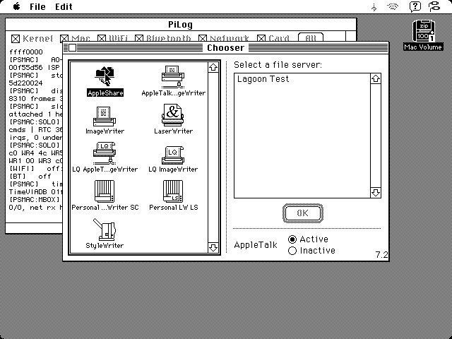

# Lagoon on the classic Mac OS

Lagoon's core (SMB 2/3, AFP, NFS v3, mDNS and NetBIOS discovery, `src/core`) runs on a 68020+
Macintosh under System 7, with a front end written once in MUI (`src/mui`) for both the Amiga and
the Mac. It was built for Aurora68 (an Emu68 port that runs a Mac IIci ROM on the Pi inside a Mac
SE), and needs only System 7 and Riptide.

## How it is put together

| Part | What |
|---|---|
| `src/core` | unchanged: compiled for the Mac with `m68k-linux-gnu-gcc` |
| `src/mac/sys_mac.c` | `ln_sys.h`: memory from the application heap, time from the Mac's clock and the Map control panel's zone, Command-period as the break, the Sharing Setup name as the host name |
| `src/mac/net_mac.c` | `ln_net.h` on Riptide's interface for programs (`RTMAC_API`, a private call of Riptide's `.IPP` driver): the stack's own socket calls, run in the program's context as `bsdsocket.library` runs in an Amiga task. While a call waits, Riptide calls back the program's yield, so the Mac carries on. MacTCP has no such interface: without Riptide, Lagoon says no TCP/IP stack is running |
| `src/mui/lm_gui.c` | the front end: the share list, Browse network (mDNS and NetBIOS), the share editor with List..., and a file browser for a connected share (Open, Up, Download..., Upload..., New folder..., Delete, free space). Built-in MUI classes only. Strings from `src/mui/catalogs/Lagoon.cd` (English built in; German, French, Spanish and Italian catalogs) |
| `src/mac/mac_main.c`, `mac_thunks.S` | the Mac's start, and the thunks that put the program's A5 back when Riptide or MUI calls in |
| `Makefile.mac` | builds `build/mac/Lagoon.bin` (MacBinary, `hcopy -m`) against a Riptide tree (`RIPTIDE ?= ../riptide`): its app kit (`src/mac/app`), its MUI for the Mac (`src/mac/mui`, riptide `docs/MAC-GUI.md`) and its tools, without copying them |

The share list is `ENVARC:Lagoon/lagoon.conf`, which on the Mac is the Lagoon folder in the
Preferences folder: the same file format as on the Amiga, passwords hidden the same way.

On the Amiga the same `src/mui` front end builds against MUI 3.8 (riptide's `prefs/mui.h`
definitions with the NDK). That build has not been made yet. vbcc, the NDK and the MUI SDK are not
installed where the Mac port was written, so on the Amiga side only the GCC compile with riptide's
headers is checked.

## Tested (18 November 2026)

On Aurora68's QEMU testbed (System 7.1, Riptide with DHCP). Its network peer (`tools/pinet.py` in
the Aurora68 repository) relays TCP to Lagoon's private Samba (`tests/servers/smb`) on the host
(`PINET_FORWARD=445=127.0.0.1:4450`), and mDNS queries to `tests/servers/mdns/responder.py`
(`PINET_MDNS_RELAY`). These worked:
- the share list from lagoon.conf;
- Connect to a guest share and to a password share (user "lagoon");
- the listing, Open a folder, Up, and the free space;
- Download... through Standard File (the file on the Mac matched the server's byte for byte);
- Upload... of a Mac file (data fork) to the share;
- New folder...;
- Delete with its confirmation.

`make test` on the host passes: 2936 checks against Samba, plus the unit tests.

Not tested: AFP and NFS from the Mac (no Netatalk or nfs-ganesha on the test host), Browse network
on the Mac (the testbed's mDNS relay is written, but the run was cut short), and the Amiga MUI
build. Two fixes made after the tested run have not been tried on the Mac yet: status lines that
redraw while shown (riptide 009a191), and the yes/no window without a text field.

Known gaps: files are copied by their data fork only (resource forks and Finder types are not
carried yet: AppleDouble or the AFP fork calls would do it), the password field shows what is
typed (the Mac's MUI has no secret string yet).

## AppleTalk: Lagoon EtherTalk

System 7.1 has no EtherTalk: Apple shipped it separately (the Network Software Installer), and
the Aurora68 images have none. Lagoon brings its own, **Lagoon EtherTalk**: an AppleTalk
connection file (`src/mac/ethertalk`, built by `make -f Makefile.mac ethertalk` into
`build/mac/LagoonEtherTalk.bin`). The AppleTalk Manager stays Apple's (.MPP, .ATP, .XPP, the LAP
Manager, all in the 7.1 System file). Lagoon EtherTalk only moves datagrams between .MPP and an
Ethernet card's `.ENET` driver as AppleTalk Phase 2, and claims the node's address there.

### What it is

| Part | What |
|---|---|
| `adev.S` | the 'adev' resource (ID 168) the Network control panel calls: GetADEV (101) lists one icon per Ethernet card (Slot Manager catNetwork/typeEtherNet), SelectADEV (102, and 103 for the one already chosen) puts the card's slot and sResource ID into the parameter RAM long at $E0. Labels are "Lagoon / Slot #9", and "Lagoon Wi-Fi / Slot #9" for Aurora68's Wi-Fi unit: the panel splits "Name (x)" into two lines, as for Apple's own entries, and "Lagoon EtherTalk" on one line is wider than an icon's label |
| `atlk_glue.S` | the 'atlk' resource's two entry points (+0 the LAP write hook, +2 the calls), its relocation on the first call, and every register-level interface: the LAP Manager's 802.2 protocol handlers, LRdDispatch with our own ReadPacket/ReadRest, the VBL task, the traps |
| `ethertalk.c` | the 'atlk' (ID 168): AInstall opens the card's `.ENET` (OpenSlot), joins 09:00:07:FF:FF:FF (EAddMulti), attaches DDP (SNAP 08 00 07 80 9B) and AARP (00 00 00 80 F3) to the LAP Manager's 802.2 dispatcher (L802Attach) and becomes the LAP write hook (LWrtInsert). AGetInfo answers version 3, an extended network, one node. AAddNode claims the address .MPP picks with AARP probes (a fifth of a second apart, as many as .MPP asks: 9) and defends it afterwards. The write hook frames .MPP's datagrams as 802.3/802.2/SNAP and finds the next hop's Ethernet address through a 16-entry AARP table (answers, and gleaning from hop-0 datagrams), holding up to four datagrams while an AARP request is out |
| `tools/mkadev.py` | packs the file: type 'adev', creator 'LGNE', the two code resources, 'ICN#' -4032 (the panel skips a connection file without it), a Finder bundle |

`make -f Makefile.mac AURORA68=1 ethertalk` adds a log through Aurora68's mailbox (the Pi
kernel's log, lines `[MAC] EtherTalk: ...`); without it there is no log at all.

**Installing.** Copy `LagoonEtherTalk.bin` to the Mac (`hcopy -m` onto an HFS volume) and put
"Lagoon EtherTalk" into the System Folder's Extensions folder. Then, in the Network control
panel, click "Lagoon / Slot #9" and confirm. AppleTalk restarts on Ethernet at once, and at
every start from then on (the LAP Manager reads the choice from parameter RAM). Nothing else is
needed: no Apple EtherTalk, no Network Software Installer.

### Tested (18 November 2026, Aurora68's QEMU testbed, System 7.1)

The testbed's network peer (`tools/pinet.py` in Aurora68) decodes AppleTalk frames, and with
`PINET_ATALK=NAME` it is a small AppleTalk node too: AARP, NBP lookups for NAME:AFPServer, ASP
GetStatus, AppleTalk Echo requests to the Mac every ten seconds. These worked:
- the Network control panel lists the connection (an icon per Ethernet unit), highlights it when
  it is in use, and switches both ways. To LocalTalk: AClose, AShutDown. Back: AInstall from a
  fresh copy of the resource, AGetInfo, AOpen, AAddNode;
- at startup with the choice in parameter RAM (Aurora68's `mac.xpram=e0:098100a8`) AppleTalk comes
  up on Lagoon EtherTalk: nine AARP probes for a node in the startup range (e.g. 65375.1), then
  ZIP GetNetInfo (no router answers, so the node stays in the startup range) and NBP
  confirmations of the Mac's own name;
- AppleTalk Echo: the peer's requests reach .MPP and its replies come back unicast to the peer's
  Ethernet address, learnt by gleaning without an AARP request. The first request after startup
  went unanswered in two runs (it was delivered; .MPP did not reply), every later one was answered;
- the Chooser: AppleShare's `=:AFPServer@*` lookups go out as broadcasts, the peer's NBP replies
  come up, and the server "Lagoon Test" is listed. Choosing it sends ASP GetStatus, and the
  AppleShare client shows "Connect to the file server "Lagoon Test" as: Guest" from the answer
  (`images/mac-ethertalk-connect.png`).

`make test` on the host still passes.

Not tested: logging in and mounting a volume (the peer does not answer ASP OpenSession yet); a
router (ZIP GetNetInfo answered, zones, a network range other than the startup range); another
Mac or Netatalk on the same wire (only the peer has answered AARP); the Wi-Fi unit (listed, not
chosen); real hardware; System 6 and AppleTalk versions other than 7.1's .MPP 57. Not written yet:
zone multicast addresses (an NBP lookup in our own zone goes to the broadcast address instead),
multinodes, routing.

### What System 7.1's AppleTalk turned out to expect

The surviving documents are the 1988 "EtherTalk and Alternate AppleTalk Connections Reference"
(a Phase 1 draft: the 'adev' and 'atlk' calls, the LAP Manager calls, the write hook's
registers), Technote NW 13 ("AppleTalk: The Rest of the Story": AGetInfo, AAddNode, ADelNode,
AGetNodeRef, AOpen, AClose) and Inside Macintosh: Networking (L802Attach). The rest was learnt from
the System's own .MPP ('drvr' 9, decompressed and disassembled, not copied) and from the testbed:
- the call number in D0 is a word: .MPP sets only the low half, so a long comparison never saw
  AGetInfo, and AppleTalk took the link for a non-extended one;
- the write hook gets the next hop in D2 as network << 8 | node, and a 3-byte LAP header in front
  of the long DDP header in the first WDS entry;
- LRdDispatch is .MPP's own routine, reached through 1052(A2), and on an extended network it wants
  the whole DDP header in the Read Header Area (1(A2): 3 LAP bytes, then 13), A3 past it. With
  LocalTalk's five bytes there it compares against 0.0 and drops everything;
- the LAP Manager keeps an 802.2 frame's header behind A3 with two bytes in front: destination at
  -22, source at -16, length at -10 (the Technote's -24 for the destination is two bytes off here);
- ReadPacket and ReadRest must leave D2 alone: .MPP's echo responder keeps its place in D2 across
  ReadRest (with D2 used as a counter, its replies went to node 0, socket 0).

### Stage 3: Lagoon's bridge (not started)

A share Lagoon reaches over TCP (SMB, NFS, AFP over TCP) offered to the Mac's AppleShare client as
an AFP-over-AppleTalk server inside the Mac, so that the Finder mounts modern shares as AppleShare
volumes. What this stage showed that matters for it:
- An in-Mac server can be another node on the same Mac (a multinode, .MPP's AddNode, csCode 262,
  with AAddNode in the 'atlk': maxnodes must then be more than 1) or a socket on the user node.
  .MPP loops a datagram back without the 'atlk' when the destination is one of its own nodes (the
  LAP Manager's intranode delivery), so the bridge needs no wire at all and works over LocalTalk
  too.
- The server side is NBP registration (`=:AFPServer@*` is what the Chooser asks), ATP with
  exactly-once transactions, ASP (GetStatus, OpenSession, Command, Write, Tickle, CloseSession)
  and AFP 2.x. The peer's GetStatus answer (`server_info()` in Aurora68's pinet.py) is already
  enough for the AppleShare client's login dialog. The AFP calls map onto Lagoon's VFS
  (`src/core/ln_vfs.c`), which the SMB, AFP and NFS backends implement.
- Lagoon's own AFP backend speaks AFP over TCP (DSI). Most of its AFP encoding can be shared:
  the bridge is the server half of what the client half already parses.
- Before the bridge, the peer can grow to answer OpenSession and a few AFP calls (or relay ASP
  to a host Netatalk 2.x, which still speaks AppleTalk), to test the Mac's AppleShare client
  over Lagoon EtherTalk end to end.
