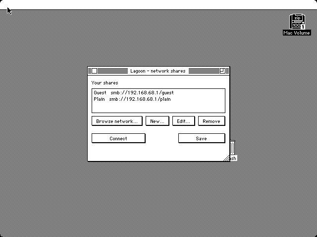
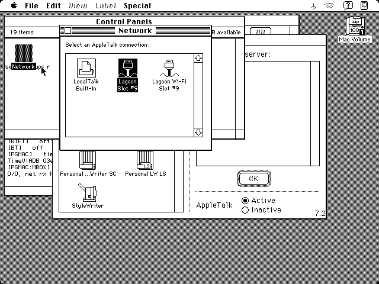
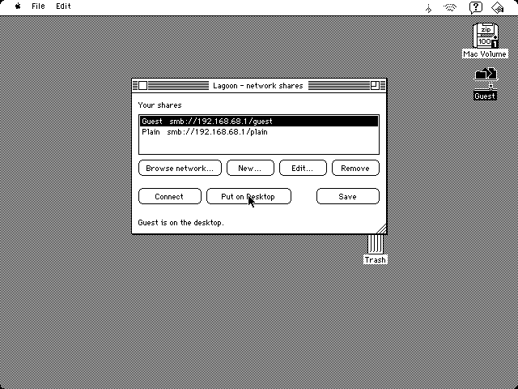
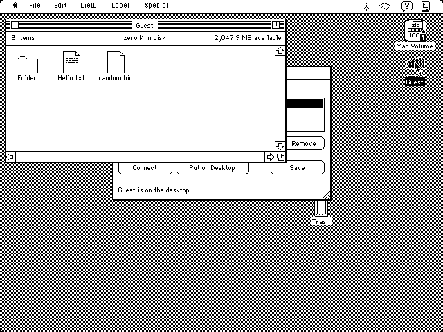
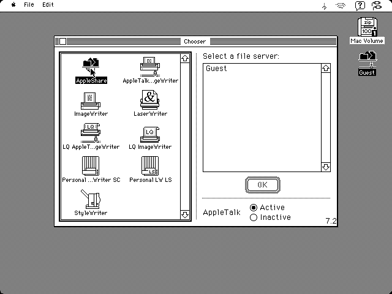
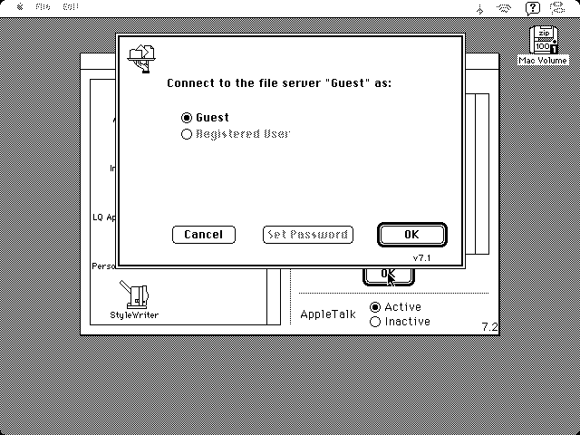
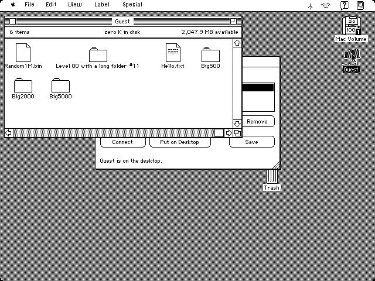

# Lagoon on the classic Mac OS

Lagoon's core (SMB 2/3, AFP, NFS v3, mDNS and NetBIOS discovery, `src/core`) runs on a 68020+
Macintosh under System 7, with a front end written once in MUI (`src/mui`) for both the Amiga and
the Mac. It was built for Aurora68 (an Emu68 port that runs a Mac IIci ROM on the Pi inside a Mac
SE), and needs only System 7 and Riptide.

## How it is put together

| Part | What |
|---|---|
| `src/core` | unchanged: compiled for the Mac with `m68k-linux-gnu-gcc` |
| `src/mac/sys_mac.c` | `ln_sys.h`: memory from the application heap, time from the Mac's clock and the Map control panel's zone, Command-period as the break, the Sharing Setup name as the host name |
| `src/mac/net_mac.c` | `ln_net.h` on Riptide's interface for programs (`RTMAC_API`, a private call of Riptide's `.IPP` driver): the stack's own socket calls, run in the program's context as `bsdsocket.library` runs in an Amiga task. While a call waits, Riptide calls back the program's yield, so the Mac carries on. MacTCP has no such interface: without Riptide, Lagoon says no TCP/IP stack is running |
| `src/mui/lm_gui.c` | the front end: the share list, Browse network (mDNS and NetBIOS), the share editor with List..., and a file browser for a connected share (Open, Up, Download..., Upload..., New folder..., Delete, free space). Built-in MUI classes only. Strings from `src/mui/catalogs/Lagoon.cd` (English built in; German, French, Spanish and Italian catalogs) |
| `src/mac/mac_main.c`, `mac_thunks.S` | the Mac's start, and the thunks that put the program's A5 back when Riptide or MUI calls in |
| `Makefile.mac` | builds `build/mac/Lagoon.bin` (MacBinary, `hcopy -m`) against a Riptide tree (`RIPTIDE ?= ../riptide`): its app kit (`src/mac/app`), its MUI for the Mac (`src/mac/mui`, riptide `docs/MAC-GUI.md`) and its tools, without copying them |

The share list is `ENVARC:Lagoon/lagoon.conf`, which on the Mac is the Lagoon folder in the
Preferences folder: the same file format as on the Amiga, passwords hidden the same way.

On the Amiga the same `src/mui` front end builds against MUI 3.8 (riptide's `prefs/mui.h`
definitions with the NDK). That build has not been made yet. vbcc, the NDK and the MUI SDK are not
installed where the Mac port was written, so on the Amiga side only the GCC compile with riptide's
headers is checked.

## Tested (18 November 2026)

On Aurora68's QEMU testbed (System 7.1, Riptide with DHCP). Its network peer (`tools/pinet.py` in
the Aurora68 repository) relays TCP to Lagoon's private Samba (`tests/servers/smb`) on the host
(`PINET_FORWARD=445=127.0.0.1:4450`), and mDNS queries to `tests/servers/mdns/responder.py`
(`PINET_MDNS_RELAY`). These worked:
- the share list from lagoon.conf;
- Connect to a guest share and to a password share (user "lagoon");
- the listing, Open a folder, Up, and the free space;
- Download... through Standard File (the file on the Mac matched the server's byte for byte);
- Upload... of a Mac file (data fork) to the share;
- New folder...;
- Delete with its confirmation.

`make test` on the host passes: 2936 checks against Samba, plus the unit tests.

Not tested: AFP and NFS from the Mac (no Netatalk or nfs-ganesha on the test host), Browse network
on the Mac (the testbed's mDNS relay is written, but the run was cut short), and the Amiga MUI
build. Two fixes made after the tested run have not been tried on the Mac yet: status lines that
redraw while shown (riptide 009a191), and the yes/no window without a text field.

Known gaps: files are copied by their data fork only (resource forks and Finder types are not
carried yet: AppleDouble or the AFP fork calls would do it), the password field shows what is
typed (the Mac's MUI has no secret string yet).

## AppleTalk: Lagoon EtherTalk

System 7.1 has no EtherTalk: Apple shipped it separately (the Network Software Installer), and
the Aurora68 images have none. Lagoon brings its own, **Lagoon EtherTalk**: an AppleTalk
connection file (`src/mac/ethertalk`, built by `make -f Makefile.mac ethertalk` into
`build/mac/LagoonEtherTalk.bin`). The AppleTalk Manager stays Apple's (.MPP, .ATP, .XPP, the LAP
Manager, all in the 7.1 System file). Lagoon EtherTalk only moves datagrams between .MPP and an
Ethernet card's `.ENET` driver as AppleTalk Phase 2, and claims the node's address there.

### What it is

| Part | What |
|---|---|
| `adev.S` | the 'adev' resource (ID 168) the Network control panel calls: GetADEV (101) lists one icon per Ethernet card (Slot Manager catNetwork/typeEtherNet), SelectADEV (102, and 103 for the one already chosen) puts the card's slot and sResource ID into the parameter RAM long at $E0. Labels are "Lagoon / Slot #9", and "Lagoon Wi-Fi / Slot #9" for Aurora68's Wi-Fi unit: the panel splits "Name (x)" into two lines, as for Apple's own entries, and "Lagoon EtherTalk" on one line is wider than an icon's label |
| `atlk_glue.S` | the 'atlk' resource's two entry points (+0 the LAP write hook, +2 the calls), its relocation on the first call, and every register-level interface: the LAP Manager's 802.2 protocol handlers, LRdDispatch with our own ReadPacket/ReadRest, the VBL task, the traps |
| `ethertalk.c` | the 'atlk' (ID 168): AInstall opens the card's `.ENET` (OpenSlot), joins 09:00:07:FF:FF:FF (EAddMulti), attaches DDP (SNAP 08 00 07 80 9B) and AARP (00 00 00 80 F3) to the LAP Manager's 802.2 dispatcher (L802Attach) and becomes the LAP write hook (LWrtInsert). AGetInfo answers version 3, an extended network, one node. AAddNode claims the address .MPP picks with AARP probes (a fifth of a second apart, as many as .MPP asks: 9) and defends it afterwards. The write hook frames .MPP's datagrams as 802.3/802.2/SNAP and finds the next hop's Ethernet address through a 16-entry AARP table (answers, and gleaning from hop-0 datagrams), holding up to four datagrams while an AARP request is out |
| `tools/mkadev.py` | packs the file: type 'adev', creator 'LGNE', the two code resources, 'ICN#' -4032 (the panel skips a connection file without it), a Finder bundle |

`make -f Makefile.mac AURORA68=1 ethertalk` adds a log through Aurora68's mailbox (the Pi
kernel's log, lines `[MAC] EtherTalk: ...`); without it there is no log at all.

**Installing.** Copy `LagoonEtherTalk.bin` to the Mac (`hcopy -m` onto an HFS volume) and put
"Lagoon EtherTalk" into the System Folder's Extensions folder. Then, in the Network control
panel, click "Lagoon / Slot #9" and confirm. AppleTalk restarts on Ethernet at once, and at
every start from then on (the LAP Manager reads the choice from parameter RAM). Nothing else is
needed: no Apple EtherTalk, no Network Software Installer.

### Tested (18 November 2026, Aurora68's QEMU testbed, System 7.1)

The testbed's network peer (`tools/pinet.py` in Aurora68) decodes AppleTalk frames, and with
`PINET_ATALK=NAME` it is a small AppleTalk node too: AARP, NBP lookups for NAME:AFPServer, ASP
GetStatus, AppleTalk Echo requests to the Mac every ten seconds. These worked:
- the Network control panel lists the connection (an icon per Ethernet unit), highlights it when
  it is in use, and switches both ways. To LocalTalk: AClose, AShutDown. Back: AInstall from a
  fresh copy of the resource, AGetInfo, AOpen, AAddNode;
- at startup with the choice in parameter RAM (Aurora68's `mac.xpram=e0:098100a8`) AppleTalk comes
  up on Lagoon EtherTalk: nine AARP probes for a node in the startup range (e.g. 65375.1), then
  ZIP GetNetInfo (no router answers, so the node stays in the startup range) and NBP
  confirmations of the Mac's own name;
- AppleTalk Echo: the peer's requests reach .MPP and its replies come back unicast to the peer's
  Ethernet address, learnt by gleaning without an AARP request. The first request after startup
  went unanswered in two runs (it was delivered; .MPP did not reply), every later one was answered;
- the Chooser: AppleShare's `=:AFPServer@*` lookups go out as broadcasts, the peer's NBP replies
  come up, and the server "Lagoon Test" is listed. Choosing it sends ASP GetStatus, and the
  AppleShare client shows "Connect to the file server "Lagoon Test" as: Guest" from the answer
  (`images/mac-ethertalk-connect.png`).

`make test` on the host still passes.

Not tested: logging in and mounting a volume (the peer does not answer ASP OpenSession yet); a
router (ZIP GetNetInfo answered, zones, a network range other than the startup range); another
Mac or Netatalk on the same wire (only the peer has answered AARP); the Wi-Fi unit (listed, not
chosen); real hardware; System 6 and AppleTalk versions other than 7.1's .MPP 57. Not written yet:
zone multicast addresses (an NBP lookup in our own zone goes to the broadcast address instead),
routing. Multinodes came with the bridge (below).

### What System 7.1's AppleTalk turned out to expect

The surviving documents are the 1988 "EtherTalk and Alternate AppleTalk Connections Reference"
(a Phase 1 draft: the 'adev' and 'atlk' calls, the LAP Manager calls, the write hook's
registers), Technote NW 13 ("AppleTalk: The Rest of the Story": AGetInfo, AAddNode, ADelNode,
AGetNodeRef, AOpen, AClose) and Inside Macintosh: Networking (L802Attach). The rest was learnt from
the System's own .MPP ('drvr' 9, decompressed and disassembled, not copied) and from the testbed:
- the call number in D0 is a word: .MPP sets only the low half, so a long comparison never saw
  AGetInfo, and AppleTalk took the link for a non-extended one;
- the write hook gets the next hop in D2 as network << 8 | node, and a 3-byte LAP header in front
  of the long DDP header in the first WDS entry;
- LRdDispatch is .MPP's own routine, reached through 1052(A2), and on an extended network it wants
  the whole DDP header in the Read Header Area (1(A2): 3 LAP bytes, then 13), A3 past it. With
  LocalTalk's five bytes there it compares against 0.0 and drops everything;
- the LAP Manager keeps an 802.2 frame's header behind A3 with two bytes in front: destination at
  -22, source at -16, length at -10 (the Technote's -24 for the destination is two bytes off here);
- ReadPacket and ReadRest must leave D2 alone: .MPP's echo responder keeps its place in D2 across
  ReadRest (with D2 used as a counter, its replies went to node 0, socket 0).

### Stage 3: what the EtherTalk stage left for the bridge

(Written before the bridge was built; kept as the plan it was. What came of it is the next
section.) A share Lagoon reaches over TCP (SMB, NFS, AFP over TCP) offered to the Mac's
AppleShare client as an AFP-over-AppleTalk server inside the Mac, so that the Finder mounts
modern shares as AppleShare volumes. What this stage showed that matters for it:
- An in-Mac server can be another node on the same Mac (a multinode, .MPP's AddNode, csCode 262,
  with AAddNode in the 'atlk': maxnodes must then be more than 1) or a socket on the user node.
  .MPP loops a datagram back without the 'atlk' when the destination is one of its own nodes (the
  LAP Manager's intranode delivery), so the bridge needs no wire at all and works over LocalTalk
  too.
- The server side is NBP registration (`=:AFPServer@*` is what the Chooser asks), ATP with
  exactly-once transactions, ASP (GetStatus, OpenSession, Command, Write, Tickle, CloseSession)
  and AFP 2.x. The peer's GetStatus answer (`server_info()` in Aurora68's pinet.py) is already
  enough for the AppleShare client's login dialog. The AFP calls map onto Lagoon's VFS
  (`src/core/ln_vfs.c`), which the SMB, AFP and NFS backends implement.
- Lagoon's own AFP backend speaks AFP over TCP (DSI). Most of its AFP encoding can be shared:
  the bridge is the server half of what the client half already parses.
- Before the bridge, the peer can grow to answer OpenSession and a few AFP calls (or relay ASP
  to a host Netatalk 2.x, which still speaks AppleTalk), to test the Mac's AppleShare client
  over Lagoon EtherTalk end to end.

## Lagoon's bridge: a share as an AppleShare volume (18 November 2026)

A share Lagoon reaches over TCP (SMB 2/3, NFS v3, AFP over TCP) is offered to the Mac's own
AppleShare client as an AFP server inside the Mac, and the Finder mounts it as an ordinary
AppleShare volume: no file system of Lagoon's own in the Mac. The AppleShare client, the
Chooser, .MPP, .ATP and .XPP are Apple's; Lagoon adds a server and a second AppleTalk node.

**Using it.** In Lagoon's main window choose a share and click **Put on Desktop**. Lagoon
connects to the share (with the user and password lagoon.conf has for it), offers it under the
share's name, and mounts it as the File Manager mounts an alias's server volume
(`PBVolumeMount`, a guest `AFPVolMountInfo`). The status line says "Guest is on the desktop."
The Chooser lists the share under AppleShare as well, and connecting there (as Guest) mounts it
the usual way. Put Away (Command-Y) takes the volume off the desktop; Lagoon goes on offering
the share until it quits or another share is put on the desktop (one at a time). Quitting
Lagoon tells the client the server is going down; AppleShare then says "The file server has
closed down". AppleTalk must be active (Chooser) on Lagoon EtherTalk; LocalTalk (whose 'atlk'
is Apple's) has not been tried.

### How it is put together

| Part | What |
|---|---|
| `src/core/afpsrv/afps_asp.c` | the server end of ASP (Inside AppleTalk, ch. 11): GetStatus, OpenSess, Command, Write with its WriteContinue, Tickle, CloseSess, Attention; repeated exactly-once requests dropped; sessions that are silent for two minutes closed. One ATP socket is the listening socket and every session's socket. ATP itself is the transport's (`AsTransport`) |
| `src/core/afpsrv/afps_afp.c` | the AFP 2.0/2.1 calls System 7's AppleShare client makes (Inside AppleTalk, ch. 13), on Lagoon's VFS, so every backend works: FPLogin (guest, and clear text when a user is configured), FPGetSrvrParms, FPOpenVol, FPGetVolParms, FPGetFileDirParms, FPEnumerate (a folder's listing kept for the following pages), FPCreateFile/Dir, FPDelete, FPRename, FPMoveAndRename, FPSetFileDirParms, FPOpenFork, FPRead, FPWrite, FPGetForkParms, FPSetForkParms, FPFlushFork, FPCloseFork, FPByteRangeLock (granted), FPMapID, FPGetUserInfo, FPGetSrvrMsg, the desktop calls (empty: the Finder draws generic icons), comments through the share's notes where the backend keeps them |
| `src/core/afpsrv/afps_names.c` | Mac Roman names, 31 bytes; a name Mac Roman cannot spell, or a longer one, is shown "start#ID" as Netatalk shows it and found again by the ID. `/` in a Mac name is `:` on the server. A table gives every folder (and every file the client has seen) a fixed ID for as long as the server runs; AFP pathnames (NUL-separated, extra NULs going up) are resolved through it |
| `src/core/afpsrv/afps_adouble.c` | Finder info and resource forks in AppleDouble `._name` files beside the file, as macOS and Samba's vfs_fruit keep them. A file without one gets a type and creator from its extension (`.txt` is TEXT/ttxt). `._` files, `.DS_Store` and Netatalk's folders are never shown; dot files are invisible |
| `src/core/afpsrv/afps_relay.c` | NBP lookup answers and the relay of the second node (below) |
| `tests/t_afpsrv.c` | a scripted AppleShare client against the server over an in-memory ATP, on the mem backend: GetStatus parsed by Lagoon's own AFP client code, sessions, logins, listing in pages, writes through WriteContinue, reads limited by the requester's room, Finder info and resource forks in `._` files, renames and moves, deletes, NBP matching, the relay (234 checks; `make test`) |
| `src/mac/bridge/lm_bridge.c` | the Mac side: the server's transport on `.ATP` (POpenATPSkt, PGetRequest, PSendResponse, PNSendRequest, PKillSendReq), the multinode (AddNode, NetWrite, RemoveNode), the thread, start, stop and `PBVolumeMount` |
| `src/mac/bridge/bridge_glue.S` | the context switch, the Time Manager task, the deferred task, the completion routine and the multinode's receive routine; the traps as fixed words |
| `src/mac/bridge/lm_pool.c` | the thread's memory |
| `src/mac/ethertalk/` | Lagoon EtherTalk now gives .MPP up to three multinodes besides the user node, and hands datagrams for this Mac's own nodes back up from a deferred task |
| `src/mui/lm_gui.c` | **Put on Desktop** (`LM_BRIDGE`, the Mac build only); strings in all five catalogs |

### Why a second node

The first version registered "*share*:AFPServer@*" with the Mac's NBP on its own .ATP socket.
The Chooser listed it and PBVolumeMount found it, but the AppleShare client gave up at once with
-5063, afpSameNodeErr: it does not use a server on its own node, and sends it nothing. A
multinode (Inside Macintosh: Networking, ch. 12) is the AppleTalk Manager's way for a Mac to be
another node: .MPP gives it an address and hands its datagrams, and every broadcast, to a receive
routine. It has no NBP and no ATP of its own, so the bridge answers NBP lookups for the share's
name there itself (and AppleTalk Echo, which the client sends the server's node first), and passes
every other datagram on, changing only the DDP addresses, to the server's .ATP socket on the user
node, and the server's answers back to the client. ATP (with exactly-once transactions), ASP and
AFP stay on the user node, on Apple's .ATP. The relay knows one client node at a time: this Mac.

Three things the testbed showed on the way:
- .MPP did not loop datagrams between the user node and the multinode itself, as the plan
  above expected: both directions came to Lagoon EtherTalk's write hook, which asked AARP for its
  own addresses. The 'atlk' now answers AGetNodeRef for every node it holds and queues a
  datagram for one of its own nodes, to go up from a deferred task as if it had come in (never
  from inside the write, which may be .MPP's own while its Read Header Area is in use). For the
  loopback .MPP puts five bytes in the multinode's header area, for a frame from the wire sixteen.
- System 7.1's .ATP leaves PGetRequest's `reqTID` (offset 22) at 0 and puts the transaction ID
  where Inside Macintosh II had it, `transID` at 46, with atpFlags' tidValid bit clear. Answered
  with TID 0, the client never took a response and gave up with aspNoServers (-1069).
- AddNode was first given the user node's own address back; AAddNode now refuses an address
  the 'atlk' already holds, and .MPP picks another.

### Why the server runs on a thread at deferred-task time

The AppleShare client is called synchronously by whatever program is in front: the Finder asks
for a folder's contents with a File Manager call and spins in it until the answer is there, and
System 7 changes programs only at WaitNextEvent. A server that answered from Lagoon's event loop
would get no time as soon as the Finder waited on it; PBVolumeMount, called by Lagoon itself,
would wait for a server that cannot run. So the server runs at deferred-task time, which comes
after every interrupt whatever program runs, spinning or not.

What the server does is the VFS (SMB, NFS or AFP over TCP through Riptide), which waits for the
network in many places. So it runs on a thread of its own, a 64 KB stack switched to from a
deferred task and switched away from whenever it waits, Riptide's waits included: the thread has
a Riptide client of its own, whose yield goes back to the deferred task (`lm_yield`,
`mac_main.c`). A Time Manager task asks for the deferred task every few milliseconds while the
thread waits, and every AppleTalk completion (and the multinode's receive routine) asks at once.

What running at interrupt time rules out, and how it is kept out:
- the Memory Manager: the thread's `ln_alloc` comes from a 768 KB pool taken at start
  (`sys_mac.c`, `lm_pool.c`; Lagoon's partition is now 2 MB);
- the Toolbox: the host name and the time zone are looked up by the application first;
- Riptide's core is one program's at a time (riptide `os_mac.c`, `mac_core_enter` is a flag, not
  a lock): calls from the application count in `lm_app_core` (`net_mac.c`), the deferred task
  leaves the thread alone while it is up, and the application's own waits put the count aside
  (Riptide has left its core before it yields);
- the stack sniffer (a VBL task that takes a stack below the heap's top for a collision, System
  Error 28): `StkLowPt` ($110) is 0 while the thread runs;
- self-modifying trap calls (riptide's `mac_pb` writes the trap word into its own code, which
  the application may be in the middle of): the thread's traps are fixed words.
The drivers are opened, intranode delivery switched on, the socket made and the multinode added
by the application before the thread starts.

### Tested (18 November 2026, Aurora68's QEMU testbed, System 7.1)

Lagoon EtherTalk chosen (`mac.xpram=e0:098100a8`), Riptide with DHCP, Lagoon's private Samba
(`tests/servers/smb`) on the host through pinet (`PINET_FORWARD=445=127.0.0.1:4450`), mouse and
keyboard through QEMU's USB devices. These worked:
- **Put on Desktop**: the thread connects to `smb://192.168.68.1/guest` (SMB 3.1.1, guest) and to
  `smb://192.168.68.1/plain` (user lagoon, signed), the multinode answers the client's NBP lookup,
  AEP echo, GetStatus, OpenSess, FPLogin as guest, FPGetSrvrParms, FPOpenVol, and
  PBVolumeMount returns 0: the volume's icon is on the desktop (log: `bridge: PBVolumeMount 0`);
- the volume opens in the Finder (three items: a folder, Hello.txt with a text icon, random.bin),
  a folder opens (`images/mac-bridge-folder.png`), Hello.txt opens in SimpleText with its text;
- random.bin (70,000 random bytes) dragged from the share to the Mac's disk: the copy on the Mac
  disk matches the server's byte for byte (`cmp`; fifteen FPReads of 4608 bytes and one of 880
  ending in EOFErr; `images/mac-bridge-copy.png`);
- SimpleText dragged from the Mac's disk to the share: on the Samba side `SimpleText` (data
  fork, 0 bytes) and `._SimpleText` (AppleDouble: Finder info APPL/ttxt, the 76,212-byte
  resource fork, identical to the original's), and the Finder shows it on the share with its
  icon (`images/mac-bridge-to-share.png`);
- Put Away: FPCloseVol, CloseSess, the icon goes; then the Chooser lists the share, connecting as
  Guest gives the volume list and mounts it again (`images/mac-bridge-volumes.png`);
- quitting Lagoon with the volume mounted: the client is told (Attention), AppleShare says "The
  file server has closed down" (`images/mac-bridge-closed.png`), Lagoon ends cleanly (thread
  stopped, multinode removed).

`make test` on the host passes (t_afpsrv 234 checks, and the other tests as before).

Not working or not known yet:
- **Two system errors in long sessions, cause not found.** SimpleText ("bad F-Line
  instruction") after opening Hello.txt from the share, nine minutes into a session with many
  copies; the Finder (the same error) on opening the Apple menu seven minutes into another. Both
  were in the programs' own code (an undefined instruction at a PC in their heap first), not in
  Lagoon's, the 'atlk' or Riptide. Other sessions of similar length ran clean. Whether the bridge
  causes them (a register or memory the deferred-task thread disturbs) or the testbed's
  translator does (docs/08 items 42 and 44 in Aurora68 record F-line errors from other causes)
  is open. The next step is a session with the bridge running and idle against one without it,
  diffing low memory and the trap tables as item 44 did. *19 November:* reproduced in minutes
  with the 0.11 test kernel, with and without the bridge; see "Large folders" below.
- One hang (run 10): the Chooser, with the same server's volume already mounted, stopped in a
  synchronous wait after its NBP lookups; directed lookups to the multinode (PConfirmName) were
  not answered then. They are now; the same steps on the next run (with the volume put away
  first) worked, but the exact case was not repeated.
- Not tried: NFS and AFP shares through the bridge (the VFS is the same, but no server here);
  registered-user login from the Mac (the server supports clear text when configured, the GUI
  offers guest only); LocalTalk or another 'atlk'; another Mac on the network using the bridge;
  real hardware; performance (copies ran at testbed speed, not measured).
- Real hardware (19 November 2026): on a Raspberry Pi 3B running Aurora68's solo board (System
  7.1, the Pi's WiFi as the Mac's only network card, the wired one hidden by the kernel), the
  user mounted an SMB share with guest access through the bridge: AppleTalk made active in the
  Chooser, Lagoon EtherTalk chosen in the Network control panel, "Put on Desktop" in Lagoon's
  window. So Lagoon EtherTalk fell back to the WiFi card as expected, and AppleTalk between the
  Mac and the bridge's node worked over it. Not yet tried there: logging in with a password,
  copying large files, speed.
- Known limits: one share at a time; the Finder writes Finder info for items it shows, so
  browsing leaves `._` files beside them on the share (as a Mac running macOS does); volumes
  larger than 2 GB show as 2 GB (AFP 2.x counts in 32 bits); the desktop database is empty
  (generic icons for documents of applications the Mac does not have); the volume's dates and
  the "closed down" time are the Mac's clock's.

### Large folders (19 November 2026)

**The report.** On the user's Pi 3B (System 7.1, the WiFi card) a guest SMB share mounted
through the bridge and folders of 99 and 120 items opened, but "a folder with a lot of files"
ended in a system error whose alert had no text and an unlabelled button (the System could not
even read the alert's strings).

**What was found.**
- *The server's memory grew with the folder and with the session.* FPEnumerate kept the whole
  listing of the folder being read: a name and a full `LnStat` (124 bytes, the 80-byte comment
  included) per item, in an array doubled by `ln_realloc` and sorted by insertion. And every
  item the client saw stayed in the ID table with its name until the server stopped. Measured
  on the host (`t_afpsrv`, the counting allocator in `src/host/sys_posix.c`): a folder of 5,000
  items left 1.15 MB in the server. The thread's pool is 768 KB, an SMB connection takes about
  200 KB of it, so the pool ran out at about 1,500 items. Out of memory, the server answered
  with errors (ASan on the host found no bad access), but listing a large folder also meant
  seconds of work at deferred-task time (the insertion sort moved 128-byte entries, the
  first-fit pool walked thousands of blocks for every name).
- *Every item cost a lookup on the share.* Finder info is read from the item's `._` file; for
  an item without one that is a failed SMB CREATE, and on Samba a failed lookup in a large
  folder reads the folder (case-insensitive matching): on the host, 5,000 items took 7.4 s.
- *Writing Finder info threw the listing away*, and the Finder writes the icon positions of a
  window it opens between the pages it reads: each page listed the folder again.
- *Offspring counts were listings.* Each folder in a window has its item count, which is a
  listing of that folder, kept for 5 s; the Finder asks again about every ten seconds. A
  window holding folders of 500, 2,000 and 5,000 items took 4.5 to 5.8 s per look.
- *Slow calls came back to the client more than once.* The client sends its request again
  while a call takes seconds; those copies were relayed to the server's socket only after the
  answer, and .ATP sent the whole answer once for each (an FPEnumerate of 4.5 s reached the
  client three times).
- *64 KB directory answers did not come through.* In the testbed every listing of the large
  folders with 64 KB QUERY_DIRECTORY answers ended in "smb: receive: timed out" and a new
  connection, three times running; with 16 KB answers the listings came through (a timeout now
  and then remains, below).
- *Microseconds went backwards at deferred-task time*, by 3 to 43 ms between two readings in
  the bridge's deferred task: a clock that steps back makes every `now - then > limit` test
  true at once (an AppleShare session closed for silence, a wait ended as timed out). Riptide's
  waits use the same clock.
- An ATP response is up to eight datagrams, which .ATP writes in one go; Lagoon EtherTalk's
  queue for this Mac's own nodes had seven usable slots and the multinode's ring eight, so the
  eighth datagram of a full response (an FPRead of 4,608 bytes) was dropped and fetched again
  after the client's retry time.

**The fix.**
- `src/core/afpsrv/afps_afp.c`: FPEnumerate reads through a window (`AfpsWin`,
  `afps_int.h`): the folder's listing stays open and only the entries around the page being
  read are kept, packed into 16 KB, in the share's own order (no sort); a page past the window
  reads on, a page before it lists the folder again, a listing left open for 30 s is closed.
  A first look at the listing notes, as bits of an 8,192-bit table, which items have a `._`
  file; the others are not looked up. Finder info written by the server marks its bit and no
  longer throws the window away. Offspring counts are kept for 30 s (and until the server
  changes something). Out of memory, FPEnumerate says kFPMiscErr, or returns what fitted.
- `src/core/afpsrv/afps_names.c`: the ID table lives in pages of 256 nodes (no large block is
  ever moved in the pool), and keeps the names of the 1,024 most recently used files. Older
  files are put away: one with a plain Mac name entirely (its slot is used again; the client
  gets a new file number, which AFP 2 without file IDs allows), one shown mangled down to its
  parent and the hash of its name, so that "start#ID" is found again (by listing the folder)
  and keeps its ID, also when the folder is listed again. Folders, and files with an open
  fork, stay.
- `src/mac/bridge/lm_bridge.c`: the thread relays what came to the multinode whenever it
  waits, in the middle of a call too; the ring has 16 slots. `src/mac/ethertalk/ethertalk.c`:
  25 slots for this Mac's own nodes. `src/mac/sys_mac.c`: `ln_ms` never goes back.
  `Makefile.mac`: SMB directory reads ask for 16 KB (`LN_SMB_DIR_BUF`, `smb_ops.c`).

Memory now, measured on the host against the private Samba with the folders below
(`ln_host_mem_*`): listing 5,000 items costs the server and the SMB connection about 210 KB
while it runs (most of it the backend's two 64 KB directory buffers) and leaves 76 KB (the
table's slots and 1,024 file names); 500 items take 18 ms, 2,000 90 ms, 5,000 0.3 s.

**Tested.**
- `make test` (t_afpsrv: 984 checks): folders of 500, 2,000 and 5,000 items with the user's
  kinds of names ("Alice68-NativeCall-b92847d-interp-00000.log", Unicode, Mac Roman, plain), in
  pages as the AppleShare client asks (100 items, 4,624 bytes): every item once, no Mac name
  twice, the table under its limit, put-away mangled names found again under the same ID and
  shown the same when the folder is listed again, Finder info written between two pages
  showing on the later page.
- The Mac, in Aurora68's testbed (0.11 test kernel, System 7.1, 16 MB, Lagoon's private Samba
  through pinet): the share's root with folders of 500, 2,000 and 5,000 items opened in the
  Finder (`images/mac-bridge-large-root.png`). Through the old build the same window took three
  timed-out SMB connections; with 16 KB answers it came in one call of 5.4 s, which the 30 s
  offspring cache now makes once in half a minute.
- Not proved: opening and scrolling the 5,000-item folder itself in icon and list views, and
  copying from it. Every testbed run with Lagoon installed ended in a Finder "bad F-Line
  instruction" within one to three minutes of a window being opened, with or without the
  bridge (below), before that step.

**The F-line errors.** Reproduced in every run of this session: the Finder executes garbage
(an illegal instruction or a CHK at $FD76xx, the same Finder code each time, then a PC sliding
through zeroed memory). Findings:
- Not the large-folder bug: it happens with the share's root holding four small items, and,
  with Lagoon installed but no share put on the desktop at all, on opening the Mac's own disk
  in the Finder (26 s after the window opened; `images/mac-fline-without-bridge.png`).
- Not the bridge thread corrupting the stack it interrupts: a run that copied the 128 bytes
  above the deferred task's stack pointer before switching to the thread and compared them
  after found them unchanged every time, until the crash. The Deferred Task Manager does not
  nest (the IIci ROM sets bit 6 of DTQueue's flags while it runs tasks, $4080A1F6), and a
  counter for nesting stayed at 0.
- The same System 7.1 image without Lagoon (no Lagoon, no Lagoon EtherTalk, Riptide with a
  static address that reaches nobody) ran clean for 2.5 minutes with the disk's window open.
- Which part of the installation sets it off (Lagoon EtherTalk with AppleTalk active on it,
  the Lagoon application, or Riptide talking to the network with DHCP, which the clean image
  did not) is not narrowed down yet; images for each alone are made and waiting for the
  testbed. The earlier sessions (18 November, the 0.10 kernel) opened Finder windows through
  the bridge for minutes before such an error, so the kernel may play a part too.
So the large-folder crash the user saw and these F-line errors are separate questions: the
large-folder work above removes the memory, time and duplicate-answer problems a large folder
caused, and the F-line errors need the testbed to tell which part of the Lagoon installation,
or the kernel under it, sets them off.

**Remaining limits.** File names: the newest 1,024 files are remembered; a mangled name put
away costs 20 bytes for the rest of the session (so about 50,000 such names fit in 1 MB). A
folder's items come in the share's order, and a listing that has to start again (the client
going back past the window) reads the folder from the start. Folders are never forgotten. AFP
2's StartIndex is 16 bits: a folder past 65,535 items shows the first 65,535. An offspring
count may be up to 30 s old when something else changes the share. The first look for `._`
files is one more listing of the folder each time it is listed from the start.

**If the crash persists, send:** the number of items in the folder (and whether it holds many
folders), Lagoon's version, the size Lagoon's Get Info gives it, About This Macintosh (the
memory and the largest unused block), the exact alert (its ID, if MacsBug or a bomb number
shows one), and PiLog's kernel log from Put on Desktop to the crash with "Kernel" ticked (the
lines "afpsrv: enumerate ...", "smb: ..." and "[PSMAC:EXC] ... PC ..."). Whether the Finder
also crashes opening a large folder on the Mac's own disk with Lagoon running but nothing put
on the desktop would tell the two causes apart.

### Installing

`make -f Makefile.mac` builds `build/mac/Lagoon.bin` and `build/mac/LagoonEtherTalk.bin`
(`AURORA68=1` for the testbed's log). Lagoon EtherTalk goes into the Extensions folder and is
chosen in the Network control panel (above); Lagoon anywhere, with Riptide installed. The
bridge needs nothing else.
