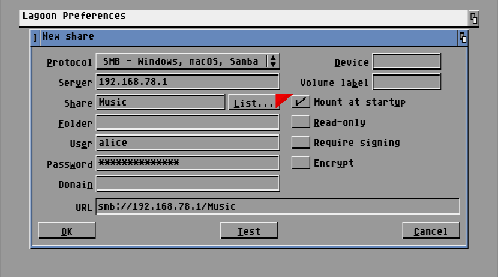
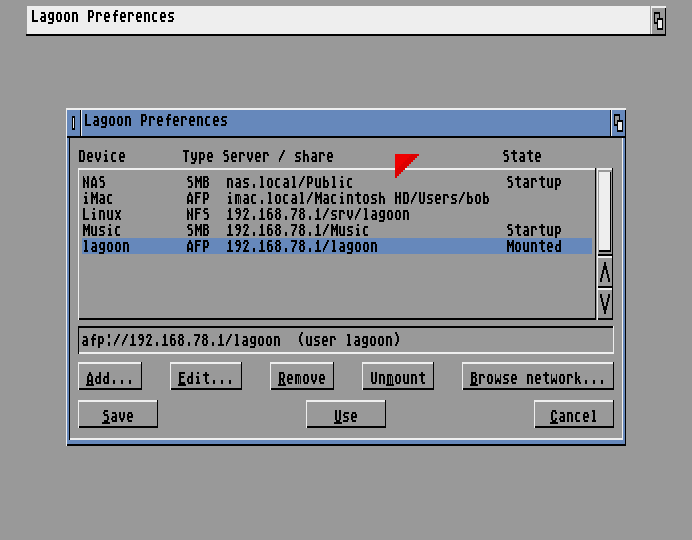
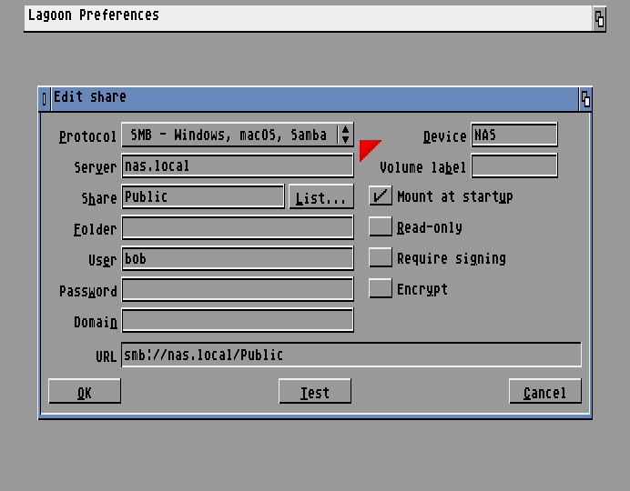
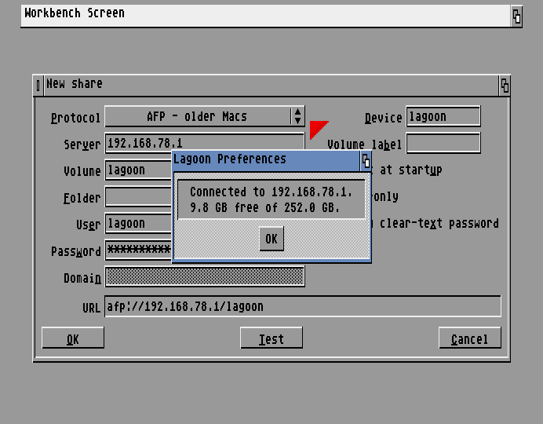
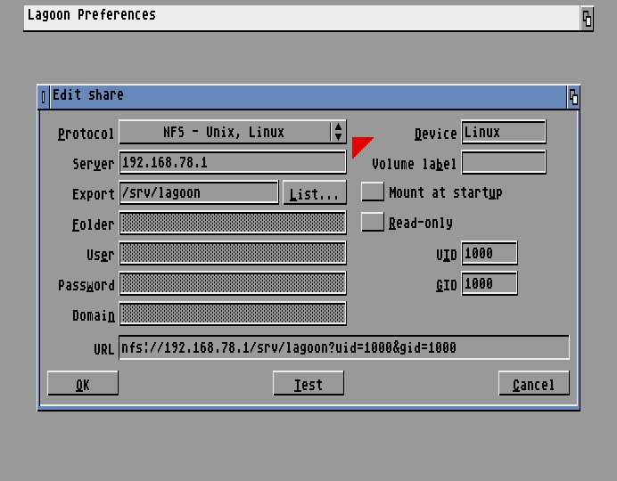
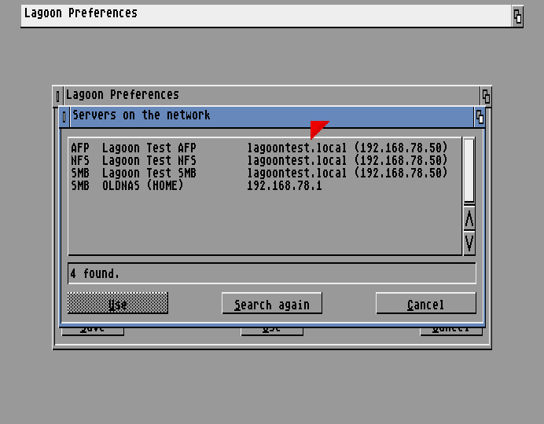
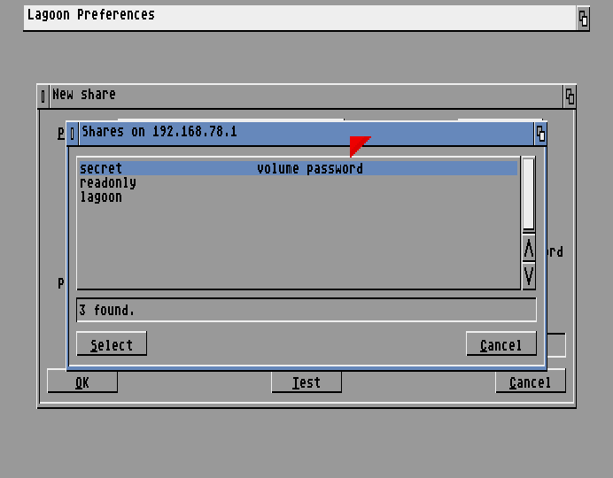

# LagoonPrefs

`SYS:Prefs/LagoonPrefs` edits the list of network shares Lagoon knows about
(`ENVARC:Lagoon/lagoon.conf`), finds servers on your network, tests a share
before you save it, and mounts or unmounts shares. It uses GadTools and
Intuition only (no MUI), needs AmigaOS 3.0 or newer, follows your screen
font and fits a 640x200 (NTSC) or 640x256 (PAL) Workbench with topaz 8;
when the windows would not fit with the screen font it falls back to topaz 8.
`tools/mkcatalog.py check` makes sure every translation fits 640 pixels
with topaz 8. The share editor on a 640x200 NTSC screen:





## The share list

Each line is one share: its **device** name (the share is mounted as
`NAS:`), the protocol, the server and share, and its state: *Mounted* when
the device is there now, *Startup* when it is mounted at boot by
`Lagoon MOUNTALL`. The line below the list shows the selected share's URL
and user name.

| Button | Does |
|---|---|
| **Add...** | a new share in the editor |
| **Edit...** | the selected share in the editor (also double-click or Return) |
| **Remove** | removes the selected share (asks first; also Del) |
| **Mount / Unmount** | mounts the selected share as it is in the list now (saved or not) with the same code `C:Lagoon MOUNT` uses (`src/amiga/mount.c`), with a busy pointer while it connects and logs on; Unmount refuses while files are open on the volume |
| **Browse network...** | finds servers (below) and starts a new share from the one you pick |
| **Save** | writes `ENVARC:Lagoon/lagoon.conf` (the old one becomes `lagoon.conf.bak`) and `ENV:Lagoon/lagoon.conf`, then quits |
| **Use** | writes `ENV:Lagoon/lagoon.conf` only (until the next reboot), then quits |
| **Cancel** | quits without writing anything (also Esc and the close gadget) |

Menus, as in the system preferences editors:

| Menu | Item | Key | Does |
|---|---|---|---|
| Project | Open... | Amiga-O | load a share list from a file |
| | Save As... | Amiga-A | write the list to a file |
| | Last Saved | Amiga-L | reload `ENVARC:Lagoon/lagoon.conf` |
| | Restore | Amiga-R | reload the list as it was when LagoonPrefs started |
| | Quit | Amiga-Q | quit without writing |
| Edit | Reset to Defaults | Amiga-D | an empty list |

Every button has a keyboard shortcut (the underlined letter); Cursor
up/down select a share (with Shift: the first / last).

## The share editor



| Field | Meaning |
|---|---|
| **Protocol** | *SMB* for Windows, macOS (its file sharing is SMB), Samba and NAS boxes; *AFP* for older Macs (OS X 10.x, AFP-only Time Capsules) and Netatalk; *NFS* for Unix and Linux servers |
| **Server** | host name (`nas.local`, `nas.example.org`) or address (`192.168.1.10`); `host:port` for a non-standard port |
| **Share** / **Volume** / **Export** | the SMB share, the AFP volume or the NFS export path (`/srv/data`). **List...** asks the server and offers its shares in a pick list (SMB needs a user and password for that on most servers) |
| **Folder** | optional: mount a folder inside the share (`Music/Old`); not for NFS (put it into the export path) |
| **User**, **Password** | your account on the server; empty = guest. The password is shown as `*` |
| **Domain** | SMB only: the Windows domain or workgroup if the server wants one (usually empty) |
| **Device** | the AmigaDOS device name without `:` (1 to 30 characters, no `:`, `/` or spaces, unique in the list). Left empty, it is made from the share name |
| **Volume label** | the name the volume has on Workbench; empty = the share name |
| **Mount at startup** | mounted by `Lagoon MOUNTALL` in `S:User-Startup` |
| **Read-only** | mount without write access |
| SMB: **Require signing**, **Encrypt** | refuse servers that do not sign every message; ask for SMB 3 encryption |
| AFP: **Allow clear-text password** | only for very old servers that support nothing better: the password crosses the network readable |
| NFS: **UID**, **GID** | the Unix user and group the Amiga acts as (empty: the server's defaults) |

The **URL** line shows what is stored (`smb://nas.local/Public?sign=required`),
never with the password. **Test** connects with these settings, reads the
free space and disconnects again, with a busy pointer meanwhile, and shows
"Connected to nas.local. 1.2 TB free of 3.6 TB." or the reason it failed
("logon failure (bad user or password)", "host not found", ...).


**OK** checks the fields and takes the share into the list; **Cancel**
forgets the changes. NFS shares use UID/GID instead of user and password:



## Browse network



**Browse network...** searches for about five seconds and lists the file
servers it finds:

* **mDNS / DNS-SD** (Bonjour, RFC 6762/6763): servers that announce
  `_smb._tcp` (Macs, Windows 10/11 with network discovery, Samba with
  Avahi, most NAS boxes), `_afpovertcp._tcp` (Macs, Netatalk) and
  `_nfs._tcp` (NAS boxes; the export path comes from the announcement).
  LagoonPrefs asks the multicast group 224.0.0.251 (port 5353) from its own
  port, and from port 5353 too when the TCP/IP stack lets it, and follows up
  with SRV/TXT/A queries for what the first answers left out.
* **NetBIOS name service** (RFC 1001/1002, UDP port 137): older Windows
  machines and NAS boxes that do not speak mDNS. A broadcast name query
  finds them, a node status request gets their name and workgroup. Their
  address goes into the share (NetBIOS names often do not resolve through
  DNS).

Pick a server and press **Use** (or double-click it): the editor opens with
the protocol and server filled in and asks the server for its shares at
once; if that needs a password, enter user and password and press
**List...**. The pick list (Return or double-click picks one):


 **Search again** repeats the search.

Servers in other subnets are not found this way (multicast and broadcast
stay in the local network): enter them with **Add...**. WS-Discovery
(Windows 10/11 without SMB1 or Bonjour) is not supported yet; such PCs are
usually found by mDNS, or enter them by name.

Lagoon resolves `name.local` host names itself (mDNS) when the TCP/IP stack
cannot, so a share on `nas.local` works without a DNS server.

## Starting it from the Shell

```
LagoonPrefs [FROM=file] [EDIT] [USE] [SAVE] [PUBSCREEN=name] [LANGUAGE=name] [DEBUG]
```

`FROM` edits another file (default: `ENV:Lagoon/lagoon.conf`, or
`ENVARC:` when `ENV:` has none). `USE` / `SAVE` write `FROM` to `ENV:` (and
`ENVARC:`) without opening a window, like the system editors. `PUBSCREEN`
opens on a public screen. `LANGUAGE` picks a catalog other than the one of
your Locale preferences, e.g. `LANGUAGE=deutsch`. `DEBUG` prints the
window events to the Shell (used by the emulator test).

## Languages

LagoonPrefs speaks English (built in), German, French, Spanish and Italian
(`LOCALE:Catalogs/<language>/LagoonPrefs.catalog`, installed by
Install_Lagoon). The catalog sources are
`src/amiga/prefs/catalogs/LagoonPrefs.cd` and one `.ct` file per language;
`tools/mkcatalog.py` builds the catalogs and `strings.h` and checks that
every translation is complete, has the same `%` formats and no clashing
keyboard shortcuts. New translations are welcome: copy a `.ct` file.
(The emulator test runs the AROS ROM, which has no locale.library, so the
catalogs are checked by the tool, not on screen.)

## The share list file

`ENVARC:Lagoon/lagoon.conf`, copied to `ENV:Lagoon/` at boot; the format
is described in `src/core/ln_conf.h`:

```
# Lagoon shares
share name="NAS" url="smb://nas.local/Public?sign=required" user="bob" pass="~..." automount=yes
share name="Linux" url="nfs://server/srv/data?uid=1000&gid=1000"
```

LagoonPrefs keeps keys and options it does not know. Passwords are only
obfuscated, not encrypted: the file is as private as your Amiga.

URL options written by the editor: SMB `sign=required`, `encrypt=yes`; AFP
`cleartext=yes`; NFS `uid=N`, `gid=N`. Other options in a URL (for example
`dialect=3.1.1`) are kept as they are.

## Troubleshooting

* **"No TCP/IP stack is running"**: start your stack (Riptide, Roadshow,
  Miami ...) first.
* **Browse finds nothing**: the server may be in another subnet, or its
  discovery is switched off (Windows: *Network discovery*; Samba: Avahi or
  `nmbd`). A firewall on the server must let UDP 5353 / 137 through.
  Enter the server by hand.
* **List... says "logon failure"**: enter user and password first; many
  servers do not show their shares to guests.
* **Test fails with "host not found"**: try the address instead of the
  name; for `name.local` the server must announce itself by mDNS.
* **Mount fails**: the message gives the reason (logon failure, volume
  password needed, `L:lagoon-handler` missing ...); `Lagoon MOUNT NAS` in
  a Shell shows the same.

## For developers

`src/amiga/prefs/`: `lagoonprefs.c` (main window, files, menus),
`editor.c` (share editor, password hook, Test), `browse.c` (network
browser, share pick list), `gui.c` (fonts, layout helpers, requesters,
catalog), `strings.h` (generated). Discovery is portable core code:
`src/core/ln_mdns.c` and `src/core/ln_netbios.c`, tested natively by
`tests/t_mdns.c` (canned packets + `tests/servers/mdns/responder.py`) and
`tests/t_netbios.c` (canned packets + a private Samba `nmbd`,
`tests/servers/netbios/nmbd.sh`). `tests/amiga/run_prefs_emu.sh [OUTDIR] [pal|ntsc] [LANGUAGE]` drives
LagoonPrefs on the emulated A1200 with the keyboard (Riptide as the stack):
main window, editors, a new share with a masked password, Browse against
the mDNS responder and a private nmbd, then an AFP share against Netatalk
(List, Test, Mount, Unmount, Mount), Save, and checks `lagoon.conf` in
`ENVARC:`/`ENV:` (with the `.bak`) and that the mounted volume reads. It
takes the screenshots in `docs/images/`.
